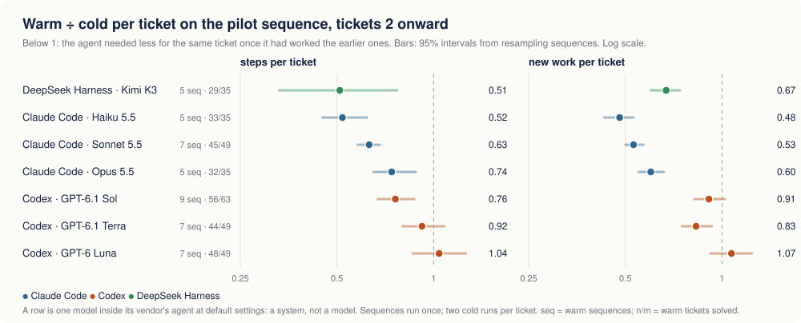

# SWE-Odyssey

Do coding agents learn on the job?

## Why

A model's weights are fixed, but an agent that keeps working in one system accumulates
experience of it: where things live, how they are deployed, what broke last time. A human
engineer turns that experience into speed. An engineer who has worked in a system for a week
needs fewer steps for the next ticket than one who arrived this morning.

Coding benchmarks mostly miss this. They hand an agent one ticket from a clean start and
score pass or fail, so every ticket is the agent's first day. SWE-Odyssey measures the
continual-learning question directly: **when an agent has already worked in a system, does
it do the next ticket better than a fresh agent would?**

## What it measures

An agent works through a **sequence of tickets in one system**. Each ticket is measured twice:

- **cold**: a fresh agent with no history solves the ticket alone;
- **warm**: one agent solves every ticket in order, with its session resumed between tickets,
  so everything it saw and did earlier is available to it.

Learning shows up as the warm agent needing less than the cold one for the same ticket. The
result is the **warm ÷ cold ratio per ticket**; below 1 means experience helped.

| Measure | What it counts |
|---|---|
| solved | hidden tests pass |
| steps | model calls the agent made on the ticket |
| new work | new tokens in the ticket: what the model wrote plus context that entered its prompt for the first time |
| time | wall-clock time the agent spent on the ticket |
| dollars | every token of the ticket's model calls at list price |

Dollars are reported alongside but are not the point. A long session re-reads its own
history on every call, so an agent can learn, take fewer steps and still cost the same.

Ticket order is rotated across sequences so that position is not confused with difficulty.

## How systems line up so far



Each row is one system (a model inside its vendor's agent) on the pilot sequence,
`atlas-commerce`: one small e-commerce backend on a local AWS emulator, seven tickets that mix
deploying infrastructure, writing code, repairing a production fault and tightening an access
policy. Every ticket was run cold twice and warm in five to nine rotated orderings. The figure
is regenerated from the run data by `scripts/analysis/readme_figure.py`; time and dollar ratios
come out of `odyssey analyze`. More systems are being added as they finish.

## Run it

Needs Docker, [Harbor](https://docs.harborframework.com/tasks/multi-step) 0.22 and
[uv](https://docs.astral.sh/uv/). Model API keys go in the environment Harbor runs in.

```sh
# Compile: 14 rotated orderings of the tickets, and one cold task per ticket.
uv run python scripts/atlas/compile_atlas.py compile sequences/atlas-commerce --out build/atlas/williams --design williams
uv run python scripts/atlas/compile_atlas.py compile sequences/atlas-commerce --out build/atlas/cold --design cold

# Check the setup with the reference agent: every step should score 1.
harbor run -p build/atlas/williams/<one ordering> -a oracle -o jobs/atlas --job-name oracle -n 1 -y

# Cold: each ticket alone. Warm: every ordering in turn, session resumed between tickets.
harbor run -p build/atlas/cold -a claude-code -m anthropic/<model> -o jobs/atlas --job-name cold1 -n 1 -y
harbor run -p build/atlas/williams -a claude-code -m anthropic/<model> --resume-trajectory -o jobs/atlas --job-name warm -n 1 -y

# After each job: remove the trial's leftover containers.
python3 scripts/atlas/cleanup_job.py jobs/atlas/<job name>

# One row per ticket attempt, then the warm ÷ cold ratios.
uv run python -m odyssey.cli account jobs/atlas --out jobs/atlas/segments.csv
uv run python -m odyssey.cli analyze jobs/atlas/segments.csv                     # new work
uv run python -m odyssey.cli analyze jobs/atlas/segments.csv --metric sdc_usd    # dollars
```

## Status

This is an early pilot, built in a few days with heavy use of AI agents.

- No human has yet reviewed every ticket, grader and trajectory.
- Each model runs in its vendor's own agent at default settings; model and harness are
  measured as one unit.
- The agent has root in the container that grades it and the task has no network restriction
  yet, so results rely on agents not trying to cheat.

## Repository layout

| Path | What |
|---|---|
| `sequences/atlas-commerce/` | the pilot sequence |
| `scripts/atlas/` | compile, validate and clean-up tools for it |
| `odyssey/` | shared tooling: compile sequences to Harbor tasks, validate, account, analyse |
| `docs/SPEC.md` | the contract every sequence follows |
| `tests/` | unit tests (`uv run pytest`; `uv run pytest scripts/atlas/test_compile_atlas.py` for the atlas compiler) |
| `drafts/` | earlier and unfinished task sets and notes; see [drafts/README.md](drafts/README.md) |

## Licence

MIT; see [LICENSE](LICENSE). Material from other projects under `drafts/` keeps its own
licence; see [THIRD_PARTY_NOTICES.md](THIRD_PARTY_NOTICES.md).
